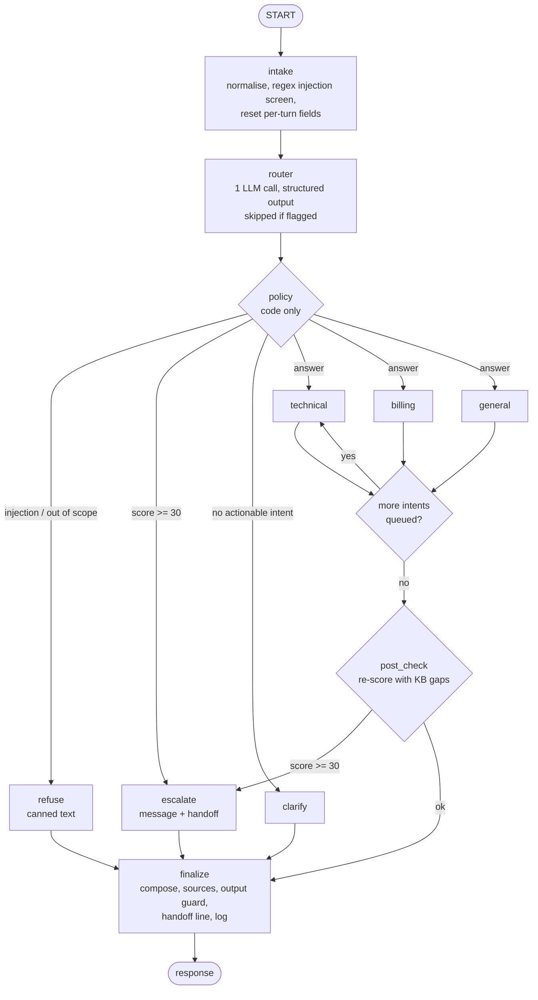

# Architecture

Current architecture of the Smart Bank Customer Support Agent, verified against the implementation as of 2026-11-08 (compiled graph inspected, offline suite 66/66 passing). It describes what is built, not what is planned. Gaps against the target design are listed in section 10 and tracked in [product/KNOWN_ISSUES.md](product/KNOWN_ISSUES.md).

## 1. Scope and design principles

The system is a single-process Python library with one entry point, `run_agent(query, thread_id, customer_id) -> str`. It is read-only, grounded in a 17-entry English knowledge base, and backed by 10 synthetic customer profiles. It is not a service: there is no API, authentication or UI yet (Phases 4 to 5).

| Principle | Consequence in the design |
|---|---|
| **Code decides, the model reports** | The LLM classifies and writes text. Refusal, clarification and escalation are chosen by deterministic policy, so they are testable and auditable. |
| **Facts before words** | Knowledge-base retrieval happens before any answer is generated; answers are then checked against the retrieved text. |
| **Identity is not model input** | The customer id travels in the runtime configuration and is bound into the tools by closure. The model never sees it as a parameter. |
| **Untrusted text stays fenced** | Customer text, history and tool output are wrapped in delimiters and declared untrusted in every prompt. |
| **Fail safe, never crash** | Every external dependency has a defined fallback, and the entry point never raises. |

## 2. Components

| Layer | Module | Responsibility | Calls the LLM |
|---|---|---|---|
| Interface | `graph.py` | `run_agent`, `run_agent_detailed`; never raise | indirect |
| Orchestration | `graph.py` | LangGraph `StateGraph`, nodes, conditional edges, in-memory checkpointer | indirect |
| Decisions | `router.py` | One structured-output call that turns a message into a routing form | yes (1 call, 2 attempts) |
| | `policy.py` | Injection pre-screen, actionable intents, escalation scoring, queues | no |
| Knowledge | `kb.py`, `tools.py` | Load and validate the KB; keyword search; customer-context access | no |
| Generation | `specialists.py` | Answer one intent from retrieved entries | yes (1 to 4 calls per intent) |
| | `escalation.py` | Write the escalation message, build the handoff payload | yes (1 call) |
| Safety | `guards.py` | Input normalisation, number grounding, output checks, canned EN/ES text | no |
| Support | `config.py`, `llm.py`, `log.py`, `schemas.py` | Settings, model client, JSONL logging with redaction, data shapes | no |

## 3. Request flow

`NEXT` is not a node; it is the edge function that selects the next queued intent's specialist, or `post_check` when the queue is empty. Specialists run sequentially, up to three intents per message.

### Representative paths

| Scenario | Path | LLM calls |
|---|---|---|
| Prompt injection (Q11) | intake (regex hit) -> router skipped -> policy `refuse_injection` -> refuse -> finalize | 0 |
| Routine question (Q03, dispute a charge) | intake -> router -> policy -> billing (retrieve `bill-003`, generate) -> post_check -> finalize | 2 |
| Fraud or demand for a manager (Q10, Q15) | intake -> router -> policy (score >= 30) -> escalate (KB lookup, write message, build handoff) -> finalize | 2 |
| Vague frustration, second turn | policy `clarify` becomes escalate through the repeated-unresolved reason | 1 per turn |
| Router outage | two failed router attempts -> policy `SYSTEM_FAILURE` -> escalate with a canned acknowledgement | 0 successful |

## 4. State model

State is a LangGraph `TypedDict` of plain dictionaries (kept simple for checkpoint serialisation). The checkpointer is keyed by `thread_id`.

| Lifetime | Fields |
|---|---|
| Persistent per thread | `messages` (append reducer), `turn_count`, `unresolved_turns`, `injection_flags`, `handoff`, `awaiting_clarification` |
| Per turn (all overwritten by `intake`) | `query`, `trace_id`, `trace`, `flagged`, `route`, `decision`, `escalation`, `answers`, `idx`, `response`, `new_handoff`, `esc_kb_ids` |
| Not in state | `customer_id`, passed through `config["configurable"]` so the model cannot influence it |

Resetting per-turn fields on every `intake` stops one turn's data leaking into the next. A flagged injection message is replaced in `messages` by `[message removed by policy]` (same message id, so the reducer overwrites it).

## 5. Decision layer

### 5.1 Router contract

One call, `with_structured_output(RouteDecision, method="function_calling")`, temperature 0, two attempts. Returning no result on the second failure is treated as a system failure and fails closed.

| Field | Meaning |
|---|---|
| `language` | Reply language (English and Spanish have canned text) |
| `scope` | `in_scope`, `out_of_scope` or `injection` |
| `intents` | Up to 3, each with a category (technical, billing, general), an English one-line summary and a confidence |
| `ambiguity`, `clarifying_question` | Whether the message needs a question back |
| `sentiment` | 0 neutral, 1 frustrated, 2 distressed |
| `signals` | `active_fraud`, `explicit_human_request`, `legal_threat` |
| `amount_usd` | Amount mentioned, if any |

Only the router sees conversation history (last 6 messages) and the pending clarifying question. Numeric fields carry no schema constraints on purpose; values are clamped in code.

### 5.2 Policy

Evaluated in order: a regex or router-flagged injection is refused; out-of-scope is refused; otherwise the escalation score is computed. If the score reaches the threshold the case is escalated; else if at least one intent has confidence >= 0.5 the message is answered; else the system clarifies. A clarify decision while a handoff is already open becomes an acknowledgement instead of a new question.

### 5.3 Escalation score

One score, one threshold (30), HIGH priority from 60, capped at 100. The model supplies signals; this function decides.

| Reason | Points | Queue |
|---|---|---|
| `ACTIVE_FRAUD` | 70 | `fraud_ops` |
| `LEGAL_OR_REGULATORY_THREAT` | 60 | `compliance` |
| `EXPLICIT_HUMAN_REQUEST` | 40 | `customer_care_supervisor` |
| `REPEATED_UNRESOLVED` (second consecutive unresolved turn) | 30 | `tier2_support` |
| `SYSTEM_FAILURE` | 30 | `tier2_support` |
| `KB_GAP` (some intent had no KB match) | 15 | `tier2_support` |
| `EMOTIONAL_DISTRESS` (sentiment 1 or 2) | 10 or 25 | `customer_care_supervisor` |

Modifiers add context but apply only when a non-emotion reason exists, so emotion alone never triggers escalation by itself: amount over $1,000 (+20) or $250 (+10), an unresolved ticket (+10), Premier tier (+5), tenure of five years or more (+5). The highest-weighted reason selects the queue and is reported as the primary reason.

Worked example (Q15, "I demand to speak to a manager"): `EXPLICIT_HUMAN_REQUEST` 40 + `EMOTIONAL_DISTRESS` 25 = 65, so priority HIGH, queue `customer_care_supervisor`.

## 6. Answer generation and grounding

1. **Prefetch.** `search_kb(intent.summary)` runs before any model call. Search is keyword-based: tokens are stemmed and idf-weighted, topic matches weigh 3 and content matches 1, results must reach an absolute score of 4.0 and at least half of the best score, and the top 3 are kept.
2. **No match** returns a canned "I don't have that information" and records a KB miss; no model call is made.
3. **Generate.** The specialist receives the system rules, the fenced customer message and the retrieved `<kb_entry>` blocks. It may call two tools, `search_knowledge_base` and `get_customer_context` (not offered to the general specialist), for at most 3 rounds.
4. **Number guard.** Every `$` amount and `%` figure in the answer must appear in the sources. A violation, an empty reply or a model outage replaces the answer with the extractive KB text itself.
5. **Compose.** `finalize` joins the specialist outputs (headers only when specialists differ), appends a `Sources:` line with the retrieved entry ids, runs the output guard and adds the handoff line when a case was opened.

`get_customer_context` returns a minimised, read-only view (account type, tenure, open tickets, a focused subset of transactions). Because the tool is created per session with the customer id bound by closure, its schema has no `customer_id` argument.

## 7. Safety layers

| Layer | Where | What it does |
|---|---|---|
| Input normalisation | `intake` | Unicode NFKC, mojibake repair, control characters and the system's own prompt tags stripped, 2,000-character cap |
| Regex pre-screen | `intake`, `policy` | High-precision patterns for instruction override, jailbreak and prompt-disclosure phrases; a hit skips the model entirely and is refused |
| Semantic scope check | `router` | The router can label a message `injection` or `out_of_scope`; the prompt declares message and history untrusted |
| Fenced context | prompts | Customer text, history and KB entries are delimited; the same delimiters are stripped from input |
| Identity binding | tools, `graph.py` | Customer id from configuration only; tool has no id parameter |
| History scrub | `refuse` | A refused injection payload is replaced in history so it cannot affect later turns |
| Output guard | `finalize` | Blocks a planted canary string, other customers' ids and other customers' full names; on a violation the reply is replaced by a fixed fallback |
| Redaction in logs | `log.py` | Card-like digit runs and emails are masked in log events and handoffs |

## 8. Escalation handoff

When a case escalates, the handler writes a short empathetic message from KB facts (for fraud, a reason-keyed lookup finds the freeze-card and dispute steps), then builds a structured payload and appends it to `handoffs.jsonl`:

- primary and secondary reasons, priority and queue, with the score factors that produced them;
- customer context (id, account type, tenure, open tickets) when a customer is present;
- thread id, language, the excerpt of the last message;
- what the automated agents already tried (agent, KB ids, outcome).

The customer sees the message plus a one-line reference (`[Handoff <id> | Priority | Reason]`). One handoff is open per thread; later turns acknowledge it instead of creating another.

## 9. Failure behaviour and testing

| Failure | Behaviour |
|---|---|
| Router fails twice (outage, rate limit, bad output) | Fail closed: `SYSTEM_FAILURE` handoff, MEDIUM priority, canned acknowledgement, no further model call |
| Model outage during an answer | Extractive KB text instead of generated text |
| Model invents a `$` or `%` figure | Answer replaced by extractive KB text |
| No KB match | Canned "no information" reply, KB miss recorded, contributes to escalation |
| Output guard violation | Fixed fallback reply, `output_guard` event logged |
| Any graph exception | Canned apology, `run_error` logged; `run_agent` never raises |

The model client uses temperature 0, a 20-second timeout and two transport retries. Provider and model are configuration: any OpenAI-compatible endpoint, with an optional JSON body for provider-specific parameters.

**What the tests prove.** The 66 offline tests replace the model with a scripted stand-in whose router output is hand-written for each scenario. They verify wiring, policy arithmetic, guards, fallbacks and multi-turn state. A poor real router would still pass them, so real-model evaluation (Phase 3) is a separate, planned layer. The retrieval baseline and the live sample run in [../results](../results) are the first real-model evidence.

**Observability today.** The JSONL log records one `turn_end` event per turn (path, outcome, KB ids, escalation factors) plus `specialist_result`, `security_event`, `output_guard`, `router_error` and `handoff_addendum` events. There are no traces, token counts or latency metrics yet (Phase 6).

## 10. Gaps against the target design

| Area | Gap | Register | Planned phase |
|---|---|---|---|
| Retrieval | Keyword-only; 62% recall@3 on raw wording | RET-1, RET-2, RET-5 | 3 |
| Identity | No authentication; handoff states identity as verified unconditionally | SEC-2 | 4 |
| Injection | Regex is brittle in both directions; router judgement untested at scale | SEC-3, SEC-4 | 2, 3 |
| Grounding | Guard covers only `$` and `%`; sources list shows retrieved, not used, entries | SEC-6, GND-2 | 3 |
| Content | No deposit-insurance entry, so one scenario gives an unsupported assurance | GND-1 | 3 |
| Handoff lifecycle | A follow-up reply says the message was added to the handoff but nothing is recorded; handoffs never close | REL-2 | 3, 8 |
| Persistence | In-memory checkpointer; state lost on restart | REL-6 | 5 |
| Resilience | Fail-closed routing turns an outage into a handoff flood; retries can multiply requests | REL-3, REL-11 | 3, 8 |
| Privacy | Redaction misses SSNs, phone numbers, names and addresses | SEC-7 | 2, 6 |
| Validation | Verified on one model only | REL-1 | 3 |
